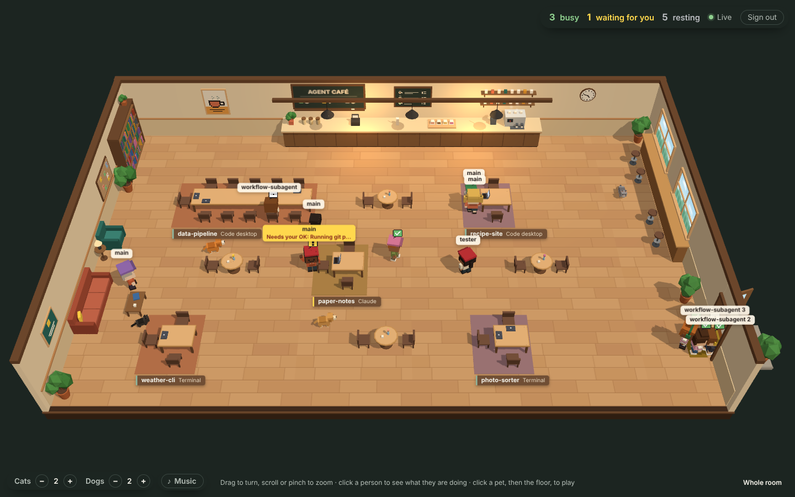
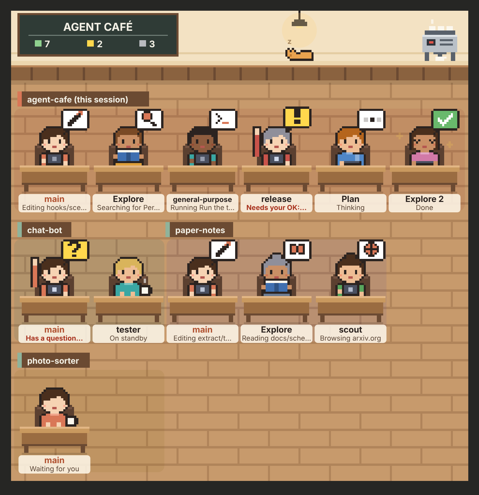
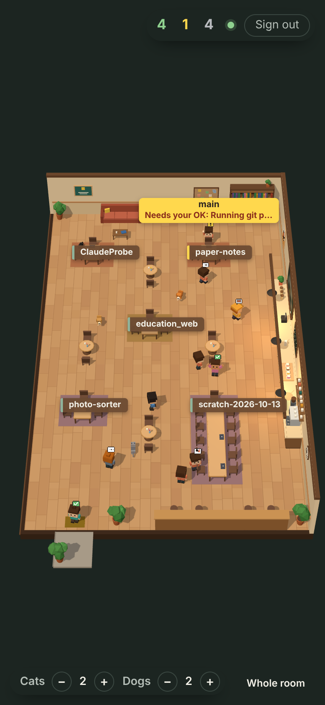

# Agent Café ☕

[繁體中文](README.zh-TW.md)

A [Claude Code](https://code.claude.com) plugin that seats every agent of your Claude sessions, the main loop and every subagent it hands work to, in a café. At a glance you see who is working on what, who has finished, and who is waiting for you.

There are two ways to watch:

| | Where | Which sessions |
| :- | :- | :- |
| **The pane** (`/cafe`) | Inside Claude Code: the terminal, and the desktop app's Code tab. A pixel-art café | Sessions on this machine that have the plugin |
| **The web page** | Any browser or phone, served from your own machine or domain. **A full-screen 3D café** (three.js) where everyone walks around, with cats, dogs and lo-fi music | Local Code and terminal sessions, plus **tasks in the Claude app** (two extra steps, see [the web page](#the-web-page-every-session-in-a-3d-café)) |



> A screenshot of the web page in Chromium (software WebGL). The sessions come from a script (not included) that simulates five sessions and a dozen agents changing what they do at random, so they change faster than real ones would.

Each agent is a little person. The bubble over their head is what they are doing; their name tag gives the details. In the pane, tags that do not fit are cut short and the full text is in the list below the picture. On the web page, click a person to open their card. The bubbles mean the same in both:

| You see | It means |
| :- | :- |
| Three dots, chin in hand | Thinking (between two tool calls) |
| Book, magnifying glass | Reading a file, searching: `Reading hooks/scene.ts`, `Searching for PermissionRequest` |
| Pencil, terminal, globe | Editing a file, running a command, browsing: `Editing src/app.ts`, `Running Run the test suite`, `Browsing arxiv.org` |
| Two little people | Handing work to a subagent |
| List, gear | Updating to-dos; using another tool (an MCP tool, say) |
| Yellow `!`, hand raised | **Waiting for you**: to approve a tool call, or to review a plan. The tag turns red: `Needs your OK: Running git push` |
| Yellow `?`, hand raised | Has a question for you (AskUserQuestion) |
| Coffee cup | Resting. The main agent says `Waiting for you`, or `Waiting on agents` while its subagents are still at work |
| Green tick | Done; leaves after 20 seconds |
| Red cross | Failed |
| Three numbers on the blackboard | Green: busy · yellow: waiting for you · grey: idle |

The pane's list adds how long each agent has been at it and how many tool calls it made; a subagent's own subagents are indented under it. On the web page, the tab's title becomes `(1) Agent Café` while someone is waiting for you.

## Install

You need **Claude Code v2.1.287 or later** (plugins with a hooks module, "mods", are on by default from that version). Check with `claude --version`.

In Claude Code:

```text
/plugin install agent-cafe --marketplace qteddie/agent_cafe
```

or from a terminal:

```bash
claude plugin install agent-cafe --marketplace qteddie/agent_cafe
```

(If your Claude Code does not know `--marketplace`, add the marketplace first: `/plugin marketplace add qteddie/agent_cafe`, then `/plugin install agent-cafe@agent-cafe`.)

Start a new session and type `/cafe`.

Installing may ask for the plugin's settings. They are all optional: leave `web_url` and `web_key` empty until you set up [the web page](#the-web-page-every-session-in-a-3d-café).

### Try it without installing

```bash
git clone https://github.com/qteddie/agent_cafe ~/agent_cafe
claude --plugin-dir ~/agent_cafe
```

This loads it for that one session. The desktop app cannot pass flags, so to load a clone there, set `CLAUDE_CODE_PLUGIN_DIRS` in `~/.claude/settings.json` (merge it with what you have) and open a new **Local** session in the Code tab:

```json
{
  "env": {
    "CLAUDE_CODE_PLUGIN_DIRS": "~/agent_cafe"
  }
}
```

Loaded this way, the plugin's id is `agent-cafe@inline` rather than `agent-cafe@agent-cafe`: use that in the `claude plugin configure` commands below.

### Is it loaded?

- `/cafe` appears in the list when you type `/`.
- Or, without opening a session, print the café as text: `claude -p "/cafe text"`.
- If it is not loaded, check your version first. An older Claude Code usually says nothing; there is just no `/cafe` (`Unknown command: /cafe`). Then see the [official troubleshooting steps](https://code.claude.com/docs/en/plugins/mods/troubleshoot).

How to update Claude Code depends on how you installed it (`which claude` tells you):

| Installed with | Update |
| :- | :- |
| The official installer (`~/.local/bin/claude`) | `claude update`. If the version is still too old, the update channel is `stable`: set **Auto-update channel** to `latest` in `/config` and run `claude update` again |
| Homebrew | The `claude-code` cask follows the stable channel, about a week behind. For the latest: `brew uninstall --cask claude-code && brew install --cask claude-code@latest` |
| npm | `npm install -g @anthropic-ai/claude-code@latest` |
| The desktop app | **Claude → Check for Updates**, then quit and reopen it |

## The pane

| Command | What it does |
| :- | :- |
| `/cafe` | Opens the café's pane. Fine while Claude is working: it does not interrupt |
| `/cafe text` | Prints the café as text into the conversation instead |
| `/cafe close` | Closes the pane |

Only two places draw panes: `claude` in a terminal, and Local or SSH sessions in the desktop app's **Code** tab. Cloud sessions in the Code tab, Claude app tasks, the VS Code chat panel and `claude -p` do not; use [the web page](#the-web-page-every-session-in-a-3d-café) to watch those.

The desktop app draws the picture:



A terminal has no pictures, so its pane is the list, the same as `/cafe text`:

```text
Agent Café — 7 busy · 2 need you · 3 idle
agent-cafe (this session)
● main — Editing hooks/scene.ts · 42s
↳ ● Explore “Find the permission events” — Searching for PermissionRequest · 42s · 7 tool calls
↳ ◆ release “Ship v0.1.0” — Needs your OK: Running git push · 42s · 7 tool calls
↳ ◐ Plan “Plan the cross-session view” — Thinking · 42s · 7 tool calls
↳ ✓ Explore 2 “Map the hooks folder” — Done · 42s · 7 tool calls
paper-notes
● main — Editing extract/tables.py · 42s
↳ ● scout — Browsing arxiv.org · 42s · 7 tool calls
```

If the picture is blank, broken or flickers, turn the `motion` setting off (see [Settings](#settings)): it is then a still image.

## The web page: every session in a 3D café

Each session tells a small server of yours who is doing what. The server seats every session in one 3D café that updates live in your browser, behind a password. It works on phones too (held upright, you look in from the door's side):



```text
Claude Code sessions ──(the plugin: the whole table every 15 s)───┐
Claude app tasks ─────(the plugin's hooks: one event at a time)───┼──▶ your server ──live──▶ your browser
```

### What happens in the café

The page is the café, full screen. Each session gets a long table: the main agent sits at its head and the subagents along its sides, and the table grows as more join. The placard in front names the session and the app it runs in. Up to 9 tables of 11.

Tables spread out: the first goes in the middle of the room, and each next one takes the free spot furthest from the others (with two or more, the corners first). Subagents sit in a checkerboard, across the table and then a seat further along on the other side, so the table fills evenly before anyone sits next to anyone.

Everyone moves about by what their agent is doing:

| The agent is | In the café |
| :- | :- |
| Editing, running commands, browsing, using other tools | At their seat, typing on a laptop |
| Reading, searching | At the bookshelf on the left, with a book or a magnifying glass |
| Updating to-dos (TodoWrite and the like) | Pinning notes to the cork board |
| Thinking | Chin in hand; after 8 seconds, pacing beside the table |
| Handing work to subagents | Standing behind their subagents, watching them work |
| **Waiting for you** (an approval, a question, a plan) | Standing by their seat, waving at you, the tag yellow |
| Resting | Fetching a coffee at the counter, then: the sofa, the window bar, a free round table, the bookshelf, petting a cat or a dog, a stroll |
| The main agent waiting on its subagents | At the head of the table with a coffee, now and then checking on them |
| Done | A little cheer, then out through the door on the right |
| Failed | Head down on the table, the laptop screen red |

New agents walk in through the door. An agent whose state flips several times a second does not run back and forth: they get up only once a state has lasted a moment, and someone at the bookshelf or the cork board stays there a few seconds before going back. Waiting for you, done, failed and a new turn show at once.

- **Look around**: drag to turn, scroll to zoom; on a phone, one finger turns and two zoom. `Whole room` (bottom right) brings back the full view.
- **Click a person** to open their card (top left): their table, what they are doing, for how long, and how many tool calls. A Claude app task's card has an `Open` link to the task. Click the floor or press Esc to close it.
- **Cats and dogs**: `Cats − +` and `Dogs − +` (bottom left) add and remove them, up to 8 each. Each has its own coat and name (cats Mochi, Miso, Luna…, dogs Biscuit, Latte, Mango…). Cats mostly sleep and now and then move to another spot; dogs run about, sit, nap, and come to sit by whoever is resting. Resting agents pet them. New pets come in through the door, and those you remove go home through it. The counts are kept in this browser.
- **Play with them**: point at one to see its name. Click it: it wakes up, jumps for joy, says `Woof!` or `Meow~` with a heart, and a pink ring shows it is picked. Then click the floor:
  - a dog: you throw a ball there. It runs after it, brings it back toward you (the camera), and sits wagging its tail.
  - a cat: you call it over. Cats do not always come: about one time in three you get only `…`.
  - Clicking someone else, Esc, or 45 seconds of ignoring it lets it go.
- **Music**: `♪ Music` (bottom left) plays a chill, lo-fi café loop: electric piano, bass, vibraphone, brushed drums and a little vinyl crackle. It is made live in your browser (Web Audio), so there is no audio file or stream to load, and it never ends the same way twice. It is off until you turn it on; the slider beside it sets the volume. Both are remembered in this browser, and when you left it on, it starts again with your first click on the page (browsers do not let a page play sound before that).
- With **reduced motion** set in your system, people do not walk: they appear where they are going.

### Which sessions show up

| Where you use Claude | Shows up? | How it reports |
| :- | :- | :- |
| **Local** sessions in the desktop app's Code tab, and the terminal | Yes, after [step 2](#2-point-your-sessions-at-it) | The plugin sends its whole table every 15 seconds and on every change |
| **Claude app tasks** (conversations where Claude uses tools) | Yes, after [step 3](#3-claude-app-tasks-optional) | The plugin's hooks send each event; the server puts the table together |
| **Cloud** sessions in the Code tab | Not yet | They do not read your machine's settings or your account's plugins |
| Plain chats with no tools | No | There are no agents there, and no hooks |

When both kinds of report arrive for one session (the hooks also report when `node` is on your machine), the plugin's whole table wins.

### 1. Run the server

The server is in `web/`. It runs in Docker, and needs nothing but Docker on a machine that stays on (your laptop with Docker Desktop is fine while you use it).

1. Make two different keys, 16 characters or more each (the server does not start otherwise; `docker compose logs cafe` says why):

   ```bash
   openssl rand -hex 24   # the reporting key: CAFE_INGEST_KEY
   openssl rand -hex 24   # the page's password: CAFE_VIEW_KEY
   ```

2. Fill them in and start it, in the repository's `web/` folder (`compose.yaml` is there; skip the clone if you have one already):

   ```bash
   git clone https://github.com/qteddie/agent_cafe ~/agent_cafe
   cd ~/agent_cafe/web
   cp .env.example .env      # put the two keys in, and your time zone (TZ)
   docker compose up -d --build
   ```

3. Open **http://localhost:8080** and enter `CAFE_VIEW_KEY`. A sign-in lasts 30 days.

If you see `Bind for 127.0.0.1:8080 failed: port is already allocated`, something on your machine already uses 8080: set `CAFE_PORT` in `web/.env` to a free port (`8787`, say) and run it again.

That is enough when Claude Code runs on the same machine. To watch from your phone, or from anywhere, put the page on a domain with https. `compose.yaml` comes with a **Cloudflare Tunnel** for that (you need a domain on Cloudflare):

1. In the Cloudflare dashboard (**Networking → Tunnels**), create a tunnel and pick **Docker**. It shows a command like `docker run cloudflare/cloudflared:latest tunnel --no-autoupdate run --token eyJ…`. Copy just the token after `--token` into `CLOUDFLARE_TUNNEL_TOKEN` in `web/.env`; the command itself need not be run.
2. Start the page with the tunnel: `docker compose --profile tunnel up -d --build`.
3. In the tunnel's **Routes → Add route → Published application**, give your hostname (`cafe.example.com`, say) the **Service URL** `http://cafe:8080`. Two things are easy to get wrong there:
   - `cafe`, not `localhost`: in the tunnel's container, `localhost` is the tunnel itself. `cafe` is the page's container.
   - `http`, not `https`: the server speaks no https of its own, and an https service URL gets a 502. Your domain is still https: Cloudflare takes care of that part.
4. Open `https://cafe.example.com`.

Without Cloudflare, put your own reverse proxy (Caddy, nginx) with https in front of `127.0.0.1:8080`. Without Docker, the server runs on [Bun](https://bun.sh), from the clone: `HOST=127.0.0.1 CAFE_INGEST_KEY=… CAFE_VIEW_KEY=… bun web/server.ts` (without `HOST`, it listens on every network the machine is on).

### 2. Point your sessions at it

Give the plugin the page's address and the reporting key:

```bash
echo '{"web_url": "https://cafe.example.com", "web_key": "<your CAFE_INGEST_KEY>"}' \
  | claude plugin configure agent-cafe@agent-cafe --values-stdin
```

or in Claude Code, `/plugin configure agent-cafe@agent-cafe`. Use `http://localhost:8080` (or your `CAFE_PORT`) when the page runs on the same machine; any other address must be https. New sessions start reporting; restart the ones already open (or run `/reload-plugins`). Without an address, the plugin makes no network calls at all.

When you load the plugin from a clone (`--plugin-dir`), you can instead put a `web.json` in the clone's root (it is in `.gitignore`: never commit it):

```json
{ "url": "https://cafe.example.com", "key": "<your CAFE_INGEST_KEY>" }
```

Once `web_url` is set, `web.json` is not read.

### 3. Claude app tasks (optional)

Claude app tasks run in Anthropic's cloud, where neither your settings nor your folders are, and where your `localhost` is out of reach: this needs the page on a public https address (the tunnel above, or your own proxy). Two things get them reporting:

1. **Upload the plugin to your Claude account**, with the page's address and key inside. Write the `web.json` above in a clone, then (it needs `zip`):

   ```bash
   sh tools/pack.sh          # makes dist/agent-cafe.zip, web.json included
   ```

   In the Claude app, **Customize → Plugins → Add → Upload plugin**, and upload the zip. New tasks then carry it. The zip holds your reporting key: upload it to your own account only, and share it with nobody.
2. **Let tasks reach your domain.** A task's network allows only some sites (GitHub, npm and the like) by default; others get a 403. In Claude's **Settings → Capabilities**, allow your domain in code execution's network access (add it to the allowed domains, or, if there is only a switch, allow all domains). On a Team or Enterprise plan, an admin changes this in the organization's settings. It applies to **new** tasks. To check, ask Claude in a new task to run `curl -sS https://cafe.example.com/healthz`: `ok` means it gets through; a 403 (`CONNECT tunnel failed, response 403`) means it is still blocked.

A task has no folder to name its table after, so it shows as `Claude · 14:05` (the app, and when it sat down), and its card's `Open` link goes to the task.

### Check

```bash
curl -s https://cafe.example.com/healthz        # ok
```

If it does not say `ok`:

- **502**: the tunnel is up but cannot find the server. The service URL is most likely not `http://cafe:8080` (see [step 1](#1-run-the-server)).
- **Cloudflare error 1033**: the tunnel is not connected. `docker compose ps` should list `agent-cafe-tunnel` (start with `--profile tunnel`); `docker compose logs tunnel` says why. Most often, the token in `web/.env` is missing or pasted wrong.

To see what the server receives, set `CAFE_DEBUG=1` in `web/.env`, run `docker compose up -d` again (`docker compose restart` does not reread `.env`), and watch `docker compose logs -f cafe`: one line per report, with only the fields the café shows.

### What the page is sent, shows and keeps

Only what the seats show is sent, and it is filtered in your session before it leaves (`eventOf` in `hooks/wire.ts`): the tool's name, a short target (a file name, a search string, a domain, a command's program), an agent's type and the few words it was given as a description, and the folder's name. **Never sent**: your prompts, session titles made from them, file contents, command arguments, tool results, and the model's answers. Strings that look like keys are never sent either (a guess, see [what it shows and stores](#what-it-shows-and-stores)).

The server keeps all of this in memory only: a restart empties it, and each session fills its table again when it next reports.

### Security

- Two separate keys: the reporting key (in the plugin's settings, in `web.json`, and in the uploaded zip, where Claude can read it) can only **send** reports. Looking at the page takes the other key, the password.
- `web_key` is not a secret setting: Claude Code keeps it in plain text in `~/.claude/settings.json`. That is why it can only write to the café, never read it.
- Wrong passwords: after 8 from one address in 15 minutes, or 40 from everyone together, the page stops taking sign-ins for a while (browsers already signed in carry on). The server tells addresses apart behind the Cloudflare tunnel only; behind your own proxy, every visitor counts as one address.
- Everything a session reports goes on the page as text, never as markup (`textContent` for tags and cards; the blackboard is drawn on a canvas). The page has a strict Content Security Policy, and three.js comes bundled in `/cafe3d.js` from your own server: no CDN.
- `compose.yaml` opens the port on `127.0.0.1` only: the world gets in through the tunnel.

### Known limits of the web page

- **Claude app tasks have no "ended" event**: a task you close stays at its table as `Waiting for you`, and leaves after 3 hours without news.
- **Tables built from hooks are put together by the server**: the events are sent one by one and at once, and sometimes arrive out of order. The server puts late ones back in place; one that is truly lost (the server restarting at that moment, say) is usually set right when the main agent's next turn ends.
- When two subagents of the same type start at the same moment, their descriptions may be swapped until each finishes.
- A turn you interrupt with Esc sends no end event: the main agent shows as busy until Claude Code's "waiting for input" notice, about a minute later.
- The hooks reporter (`scripts/report.mjs`) needs Node 18.17 or later, or Node 22.21 or later behind a proxy (as in a Claude app task, which has 22.22 today). Without `node` on your machine, your Code sessions still report: the plugin itself does that.
- Teammates (agent teams) show as ordinary subagents, and may be taken for done when the main agent's turn ends.
- **3D needs WebGL**: with hardware acceleration off or no WebGL, the page only says it cannot draw the café. There is no flat fallback (the pixel-art café is still in the pane).
- Up to 9 tables of 11 people are drawn; more only count in the numbers at the top right.
- The page is in English; add `?lang=zh-TW` to its address for Traditional Chinese (it is remembered).

## Settings

| Setting | Default | What it does |
| :- | :- | :- |
| `language` | `en` | The pane's language: `en` or `zh-TW` (the web page has its own, see above) |
| `share_sessions` | `true` | Seats the agents of your other sessions on this machine in the pane too. Off, this session neither reads nor writes the shared table |
| `motion` | `true` | Animates the pane's picture. Off, it is a still image |
| `web_url` | empty | The web page's address (see [step 2](#2-point-your-sessions-at-it)). Empty: no network calls |
| `web_key` | empty | The web page's reporting key, `CAFE_INGEST_KEY` |

Change them in Claude Code with `/plugin configure agent-cafe@agent-cafe`, or from a terminal:

```bash
claude plugin configure agent-cafe@agent-cafe            # lists them, and which are set
echo '{"language": "zh-TW", "motion": "false"}' | claude plugin configure agent-cafe@agent-cafe --values-stdin
```

Values go in as strings, `"false"` included. They take effect in new sessions. The web page's server has its own settings, in `web/.env` (see `web/.env.example`).

## What it shows and stores

Without a web page set up, the plugin runs on your machine only: no network, and no model calls. With one, it talks to that address only. You can list every Claude Code capability it uses yourself: the `calls:` line of `claude plugin validate <the plugin's folder>`.

**What it shows** is short labels, filtered first:

- Files: the name and one folder up (`hooks/scene.ts`). Never the contents; nor a name that looks like a key.
- Searches: the search string, unless it looks like a key or a token.
- Web addresses: the domain only (`example.com`), no path or query.
- Shell commands: the description the model wrote for the command (unless it looks like it holds a key); with none, only the program, plus fixed subcommands of tools like git and npm (`git push …`). **Never any arguments** (a `make` target counts as one).
- Subagents: their type, name, and the few words of description they were given (unless it looks like it holds a key). Never the prompt.
- Questions for you: their short header only.
- Other tools: to-do titles, a skill's name, who a message goes to, a workflow's title; for MCP tools, the server's and the tool's names only.
- Tool results and your conversation: never touched.

Spotting keys is a guess (well-known key prefixes, or a long run mixing letters and digits) that errs on the side of hiding. It is not a guarantee: a secret the model writes into a description that does not look like a key will show.

**What it stores**: with `share_sessions` on, each session writes its own table to the plugin's own data file on your machine (under `~/.claude/plugins/store/`) so your other sessions can read it. A session removes its entry when it ends; one that did not end cleanly stops showing after 45 seconds and is cleared after an hour.

`/cafe text` goes into the conversation, where the model reads it, so it lists only this session's agents; other sessions are only counted.

## Known limits of the pane

- **"Needs your OK" stays a moment after you approve**: Claude Code tells the plugin it is asking you, but not that you said yes, so the seat changes back only when the tool call ends.
- **The terminal shows the list only**, no picture.
- **The desktop app leaves space beside the picture**: its frame is wider than the picture. With `motion` off it is a plain image, which may fit better.
- **Other sessions' tables** are read about every 4 seconds while the pane is open, and those sessions need the plugin too.
- **Up to 4 tables of 12 seats in the picture** (9 on the web page); more only count on the blackboard and in the list.
- **Background agents**: in an interactive session, subagents run in the background by default, and the main agent's turn ends once it has handed out the work. So you will often see main with a coffee, `Waiting on agents`. That is expected.
- **A shell command's icon** is a guess from its program (`grep`, `rg`, `find` search; `cat` reads; `curl` browses); otherwise it is plain "running".

## Status

**v0.3.0**, built and tested with Claude Code **v2.1.292 to v2.1.296**. The plugin API (mods) still changes between versions, so a newer Claude Code may need changes here; please [open an issue](https://github.com/qteddie/agent_cafe/issues) when it breaks.

Tested:

- `claude plugin validate --strict` passes, `claude plugin test` passes in Claude Code's own test harness, and the 3D café type-checks with `tsc`. The event shapes the web page reads were recorded from real sessions (`tests/runs.ts`).
- Real Claude Code sessions (Linux, a separate settings folder, the model replaced by a local script, so no real model or usage): headless (`claude -p`) and the interactive terminal; the main agent thinking and calling tools, foreground and background subagents, subagents of subagents, failures, permission prompts, stopping a background agent, `/clear`, hot reload, two sessions at once.
- The desktop app's Code tab draws the pane's picture, list and legend.
- The web page's server under Bun, fed by real sessions in all three ways (the plugin's tables, hooks only, both together); sign-in limits, forged sign-in cookies and cross-site forms are refused; the page reconnects by itself after a server restart. The 3D café in Chromium (software WebGL) at desktop (1440×900) and phone (390×844) sizes, with simulated sessions, the pets and the music (on a touch screen too).
- `web/Dockerfile` and `compose.yaml` built and run under Docker Engine 29.

Not tested yet: the whole path from a Claude app task to a real domain; the real `oven/bun` and `cloudflare/cloudflared` images and the Cloudflare part (the Docker tests used stand-ins); the reporter on macOS; the 3D café on a real GPU, in Safari and on real phones; teammates, MCP elicitations, plan approvals and AskUserQuestion beyond unit tests; a real model, which does more varied things than a script.

## Development

```bash
claude plugin validate .      # what Claude Code reads from the plugin
claude plugin test            # the tests in tests/, no session or sign-in needed
npx -p typescript tsc -p .    # type check (load the plugin once first, which writes its types)

# The web page (needs Bun)
CAFE_INGEST_KEY=$(openssl rand -hex 24) CAFE_VIEW_KEY=$(openssl rand -hex 24) bun web/server.ts
bun build web/report.ts --target=node --format=esm --outfile=scripts/report.mjs   # after changing the reporter

# The 3D café (TypeScript in web/cafe3d/, bundled into web/public/cafe3d.js)
cd web && bun install                                   # three.js and its types, for development only
node_modules/.bin/tsc -p cafe3d/tsconfig.json           # type check
bun run build:3d                                        # rebuild after changing cafe3d/
```

- `scripts/report.mjs` is built from `web/report.ts` (with `hooks/wire.ts` and `hooks/describe.ts`): rebuild it when you change those. `tools/pack.sh` does it when Bun is around.
- `web/public/cafe3d.js` is built too, and committed (about 650 KB, 170 KB gzipped), so running the page and building the Docker image need no `bun install`. The server sends it compressed and with an ETag.
- Each time Claude Code loads the plugin from a folder, it writes the types of **your** version to `.claude-plugin/types/` (in `.gitignore`).
- In a debug log, look for `agent-cafe`. When the plugin itself runs into trouble it logs `could not keep up: …`.
- `bun tools/preview.ts` draws sample pane pictures to `preview/`, without Claude Code.

Where things are:

| File | What it holds |
| :- | :- |
| `hooks/register.tsx` | The only file that talks to Claude Code: listens to events, opens the pane, keeps it up to date, shares tables between sessions, reports to the web page |
| `hooks/tracker.ts` | The seating chart: after each event, who is doing what (shared by the plugin and the web server) |
| `hooks/describe.ts` | What kind of work a tool call is, and what a tag may safely show |
| `hooks/wire.ts` | What goes to the web page: which fields of a hook event are kept, where reports go, and how the server checks what it receives |
| `hooks/view.ts` | Who sits at which table, and their names; the list and the text |
| `hooks/scene.ts`, `hooks/sprites.ts` | The café drawn as one SVG; the pixel art |
| `hooks/i18n.ts` | The café's words, in English and Traditional Chinese |
| `hooks/hooks.json` | Loads the plugin's module, and runs the reporter on each hook event (it does nothing without a web page set up) |
| `scripts/report.mjs` | The hooks reporter (built, see above) |
| `web/server.ts` | The web server: reports in, sign-in, live updates out |
| `web/hall.ts` | The server's memory: every session, and hook events put back together into tables |
| `web/look.ts`, `web/page.ts`, `web/words.ts`, `web/public/` | The page's content, HTML and words; the browser's script and styles |
| `web/cafe3d/main.ts` | The 3D café's entry point: camera, rendering, tables, people, picking |
| `web/cafe3d/layout.ts`, `web/cafe3d/nav.ts` | Where everything in the room is; how people and pets find their way around the furniture (A*) |
| `web/cafe3d/mind.ts`, `web/cafe3d/guest.ts` | What an agent's state makes its person want to do, where they go, and what they do there |
| `web/cafe3d/person.ts`, `web/cafe3d/pets.ts`, `web/cafe3d/room.ts` | The blocky people and their poses; cats and dogs; the café itself |
| `web/cafe3d/music.ts` | The café's lo-fi music, made with Web Audio |
| `web/cafe3d/kit.ts`, `web/cafe3d/tags.ts` | Merged blocks and canvas textures (floor, bubbles); the name tags over the picture |
| `web/package.json` | The 3D café's development tools: three.js, types, the bundle command |
| `web/Dockerfile`, `web/compose.yaml`, `web/.env.example` | Running the page |
| `tools/pack.sh` | The plugin as a zip, for uploading to a Claude account |
| `tests/` | `cafe.test.ts` runs the whole plugin against Claude Code; `runs.ts` is recorded real events; `stage.test.ts` tests the 3D café's layout, paths and behavior; the rest test one module each |

Every hook only watches: it passes each event on unchanged, and swallows its own errors, so no tool call ever fails because of it. The reporter runs in the background and Claude does not wait for it, except for the report at the end of a turn and of a session, which waits up to 2 seconds so it leaves before the session closes. When the web page hangs, reporters pause for 15 seconds instead of piling up.

## Ideas

- Reports from Cloud sessions in the Code tab: a settings template for a repository.
- A phone notification when someone is waiting for you.
- A picture in the terminal too.
- Click a person to read their agent's conversation.
- Pets kept on the server, the same on every device.

## License

[MIT](LICENSE)
