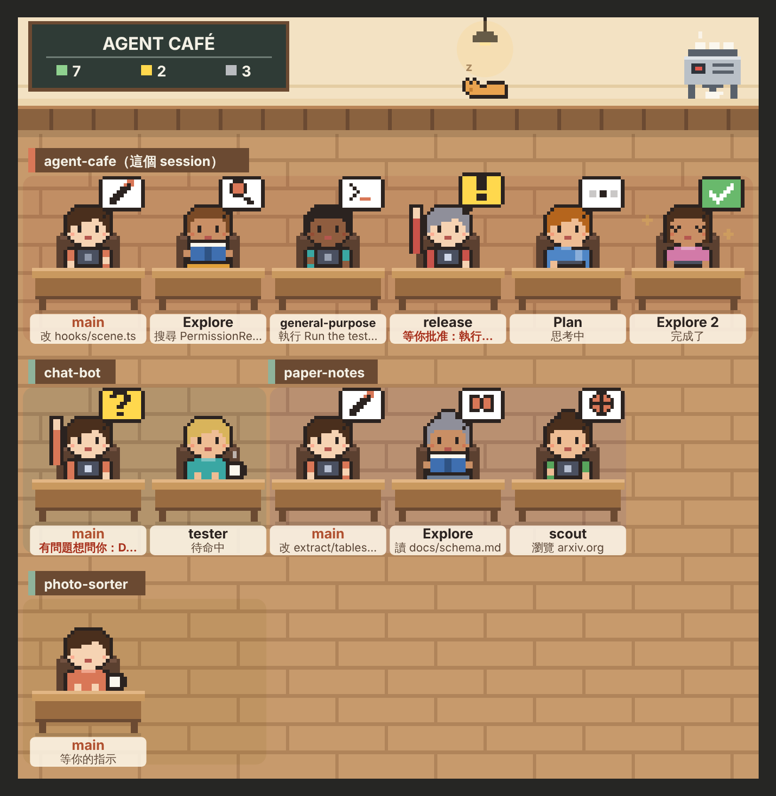

# Agent Café ☕

[English](README.md)

一個 [Claude Code](https://code.claude.com) 外掛：把你 Claude 裡的每一個 agent——主 agent 和它交辦出去的所有 subagent——請進一間咖啡廳，一眼看出誰正在做什麼、誰做完了、誰在等你。

有兩種看法：

| | 在哪裡看 | 看得到哪些 session |
| :- | :- | :- |
| **pane**（`/cafe`） | Claude Code 裡：終端機、桌面 App 的 Code 分頁。像素風的平面圖 | 這台電腦上裝了這個外掛的 session |
| **網頁版** | 瀏覽器、手機，開在你自己的電腦或網域上。**滿版的 3D 咖啡廳**（three.js），裡面的人會自己走動，還有貓、狗和 lo-fi 音樂 | Code 的本機 session、終端機，加上 **Claude App 裡的任務**（要多做兩步設定，見[網頁版](#網頁版在瀏覽器看所有-session)） |


> 這張是網頁版在 Chromium 裡的截圖（軟體算圖的 WebGL）。回報給它的是一支模擬 session 的腳本（沒有放在 repo 裡）：五個 session、十幾個 agent 隨機換著做事，所以畫面上的狀態比真的 session 換得更快。

每個 agent 是一個小人，頭上的泡泡是它正在做的事，名牌寫著細節。pane 裡名牌放不下的字會截掉，完整的寫在底下的清單裡；網頁版點一下那個人，會出現它的單子。泡泡的意思兩邊一樣：

| 你會看到 | 意思 |
| :- | :- |
| 泡泡裡三個點、手托下巴 | 思考中（兩次工具呼叫之間） |
| 書、放大鏡 | 在讀檔案、在搜尋：`讀 hooks/scene.ts`、`搜尋 PermissionRequest` |
| 鉛筆、終端機、地球 | 在改檔案、執行指令、上網：`改 src/app.ts`、`執行 Run the test suite`、`瀏覽 arxiv.org` |
| 兩個小人 | 把工作交辦給 subagent |
| 清單、齒輪 | 在整理待辦；在用其他工具（例如 MCP 的工具） |
| 黃色泡泡 `!`、舉手 | **在等你**：等你批准某個工具呼叫，或計畫寫好了等你看。名牌是紅字，例如 `等你批准：執行 git push` |
| 黃色泡泡 `?`、舉手 | 有問題想問你（AskUserQuestion） |
| 咖啡杯 | 休息中。主 agent 是 `等你的指示`；如果它的 subagent 還在忙，則是 `等 agent 回報` |
| 綠色勾勾 | 做完了，20 秒後離席 |
| 紅色叉叉 | 出錯了 |
| 黑板上的三個數字 | 綠：忙　黃：等你　灰：閒 |

pane 的清單裡多了經過時間和工具呼叫次數；subagent 交辦出去的 subagent 會縮排在它底下。網頁版有人在等你的時候，分頁標題會變成 `(1) Agent Café`。

## 安裝

需要 **Claude Code v2.1.287 以上**（有 hooks 模組的外掛，也就是 mods，從這版開始預設開啟）。可以用 `claude --version` 確認。

在 Claude Code 裡：

```text
/plugin install agent-cafe --marketplace qteddie/agent_cafe
```

或是在終端機：

```bash
claude plugin install agent-cafe --marketplace qteddie/agent_cafe
```

（你的 Claude Code 不認得 `--marketplace` 的話，先加 marketplace：`/plugin marketplace add qteddie/agent_cafe`，再 `/plugin install agent-cafe@agent-cafe`。）

開一個新的 session，輸入 `/cafe`。

安裝時可能會問外掛的設定，全部都可以不填：`web_url`、`web_key` 等你架好[網頁版](#網頁版在瀏覽器看所有-session)再填。介面預設是英文，要中文的話把 `language` 設成 `zh-TW`（見[設定](#設定)）。

### 不安裝，先試試看

```bash
git clone https://github.com/qteddie/agent_cafe ~/agent_cafe
claude --plugin-dir ~/agent_cafe
```

只對這一次的 session 有效。桌面 App 啟動 session 時沒辦法加參數，要從 clone 下來的資料夾載入的話，在 `~/.claude/settings.json` 設定 `CLAUDE_CODE_PLUGIN_DIRS`（和你原有的設定合併），再到 Code 分頁開一個 **Local** 的新 session：

```json
{
  "env": {
    "CLAUDE_CODE_PLUGIN_DIRS": "~/agent_cafe"
  }
}
```

這樣載入時，外掛的 id 是 `agent-cafe@inline`，不是 `agent-cafe@agent-cafe`：下面的 `claude plugin configure` 指令要改用這個 id。

### 確認有沒有載入

- 輸入 `/` 時清單裡有 `/cafe` 就是載入了。
- 不用開 session 也能確認，這行會直接印出咖啡廳的文字版：`claude -p "/cafe text"`。
- 沒有載入的話，先看版本。版本不夠的時候通常不會有錯誤訊息，就只是沒有 `/cafe`（`Unknown command: /cafe`）。再來看[官方的排除步驟](https://code.claude.com/docs/en/plugins/mods/troubleshoot)。

更新 Claude Code 的方式看當初怎麼裝的，用 `which claude` 可以看出來：

| 安裝方式 | 更新 |
| :- | :- |
| 官方安裝程式（`~/.local/bin/claude`） | `claude update`。更新後版本還是不夠，是更新頻道設成了 stable：在 `/config` 把 **Auto-update channel** 改成 `latest`，再跑一次 `claude update` |
| Homebrew | 預設的 `claude-code` 跟的是 stable 頻道，大約晚一週。改裝跟最新版的：`brew uninstall --cask claude-code && brew install --cask claude-code@latest` |
| npm | `npm install -g @anthropic-ai/claude-code@latest` |
| 桌面 App | 選單 **Claude → Check for Updates**，更新後整個關掉再開 |

## pane

| 指令 | 作用 |
| :- | :- |
| `/cafe` | 打開咖啡廳的 pane。Claude 正在工作時也可以下，不會打斷它 |
| `/cafe text` | 不開 pane，把目前的狀態用文字印在對話裡 |
| `/cafe close` | 關掉 pane |

會畫出 pane 的地方只有兩個：終端機的 `claude`，以及桌面 App **Code 分頁**的本機／SSH session。Code 分頁的 **Cloud** session、Claude App 的任務、VS Code 的聊天面板和 `claude -p` 都不會畫 pane；要看那些，用[網頁版](#網頁版在瀏覽器看所有-session)。

桌面 App 裡是一張圖：



終端機沒有圖片，pane 裡是文字清單，和 `/cafe text` 一樣：

```text
Agent Café — 忙 7　等你 2　閒 3
agent-cafe（這個 session）
● main — 改 hooks/scene.ts · 42s
↳ ● Explore「Find the permission events」 — 搜尋 PermissionRequest · 42s · 7 次工具
↳ ◆ release「Ship v0.1.0」 — 等你批准：執行 git push · 42s · 7 次工具
↳ ◐ Plan「Plan the cross-session view」 — 思考中 · 42s · 7 次工具
↳ ✓ Explore 2「Map the hooks folder」 — 完成了 · 42s · 7 次工具
paper-notes
● main — 改 extract/tables.py · 42s
↳ ● scout — 瀏覽 arxiv.org · 42s · 7 次工具
```

pane 裡的圖若是空白、破圖或一直閃，把 `motion` 設定關掉（見[設定](#設定)），圖會改成一張靜態圖片。

## 網頁版：在瀏覽器看所有 session

每個 session 把「誰在做什麼」送到你自己的一個小伺服器，伺服器把所有 session 放進同一間 3D 咖啡廳，瀏覽器打開就會即時更新，要輸入密碼才看得到。手機也能看（直的螢幕會從門那一側看進去）：


```text
Claude Code 的 session ──（外掛：每 15 秒送整桌）────┐
Claude App 的任務 ──────（外掛的 hooks：逐筆送事件）─┼──▶ 你的伺服器 ──即時──▶ 你的瀏覽器
```

### 3D 咖啡廳裡發生的事

整個頁面就是咖啡廳（滿版）。每個 session 一張長桌：主 agent 坐在桌頭，subagent 坐兩側，人越多桌子越長；桌子前面的木牌寫著 session 的名字和它在哪個 App。最多 9 桌、每桌 11 個人。

大家會盡量坐得分散：第一桌放在咖啡廳正中間，之後每一桌都挑離其他桌最遠的空位（兩桌以上會先放四個角落）；同一桌的 subagent 照棋盤格入座，一個坐對面、下一個隔一個位子換邊，先把整張桌子坐開，才會有人坐隔壁。

每個 agent 都是不一樣的人，每次來都長一樣：髮型、帽子、眼鏡、鬍子、衣服和身高都由那個 agent 決定。每個 session 的主 agent 穿 Claude 的橘色，其他人都不穿橘色。

每個人會照它的 agent 在做的事自己走動：

| agent 在做的事 | 咖啡廳裡的人 |
| :- | :- |
| 改檔案、執行指令、上網、用其他工具 | 坐在自己的位子上打筆電 |
| 讀檔案、搜尋 | 走到左邊的書架前看書、拿放大鏡找 |
| 整理待辦（TodoWrite 之類） | 走到軟木板前貼便條 |
| 思考中 | 手托下巴；想超過 8 秒會站起來在桌邊踱步 |
| 交辦給 subagent | 在自己的 subagent 背後看它們工作 |
| **等你**（批准、問題、計畫） | 站在位子旁邊，面向你揮手，名牌變黃 |
| 休息中 | 去吧台拿咖啡，然後隨意：坐沙發、坐窗邊吧台、坐空著的小圓桌、逛書架、摸貓摸狗、走走 |
| 主 agent 等 subagent 回報 | 端著咖啡坐在桌頭，不時走到 subagent 背後看看 |
| 做完了 | 歡呼一下，從右邊的門走出去 |
| 出錯了 | 趴在桌上，筆電螢幕變紅 |

新的 agent 從門口走進來；狀態一秒換好幾次的 agent 不會一直來回跑：要持續一下子才會起身，走到書架或軟木板的人也會待上幾秒再回座。等你、做完、出錯和新的一輪會立刻反應。

- **看**：滑鼠拖曳旋轉、滾輪縮放；手機用一指旋轉、兩指縮放。右下角 `Whole room`（中文介面是 `回到全景`）回到全景。
- **點一個人**：左上角出現它的單子：哪一桌、在做什麼、做了多久、用了幾次工具；Claude App 的任務還有 `Open`（`開啟`）可以打開那個任務。點地板或按 Esc 關掉。
- **貓和狗**：左下角 `Cats − +`、`Dogs − +`（中文介面是 `貓`、`狗`）可以加減，各最多 8 隻，每一隻的毛色和名字固定（貓叫 Mochi、Miso、Luna……，狗叫 Biscuit、Latte、Mango……）。貓大多在睡覺，偶爾換個地方睡；狗會到處跑、坐下、趴著睡，也會跑去休息中的人旁邊坐。休息中的人會去摸牠們。加的貓狗從門口進來，減掉的從門口回家。數量記在這個瀏覽器裡。
- **跟貓狗玩**：滑鼠移到牠身上會出現名字。點一下，牠會醒來、開心地跳一下、冒出愛心，說 `Woof!` 或 `Meow~`，腳下出現粉紅色的圈，表示選到了。選到之後點地板：
  - 狗：往那裡丟一顆球，牠會跑去撿，叼回來放在靠近你（鏡頭）的地方，再坐下搖尾巴。
  - 貓：叫牠過來。貓不一定理你，大約三次有一次只回你 `…`。
  - 點別的人、按 Esc，或 45 秒沒理牠，就取消選取。
- **音樂**：左下角 `♪ Music`（`♪ 音樂`）會放很 chill 的 lo-fi 咖啡廳音樂：電鋼琴、貝斯、顫音琴、刷子鼓和一點黑膠的沙沙聲。音樂是瀏覽器當場用 Web Audio 做出來的，沒有音檔也不用串流，每次都不太一樣。預設是關的，打開後旁邊的滑桿可以調音量。開關和音量記在這個瀏覽器裡；上次開著的話，你在頁面上點第一下時會自己接著放（瀏覽器不讓頁面在那之前出聲）。
- 系統設定了「減少動態效果」的話，人不會走動，直接出現在該在的地方。

### 哪些 session 會出現在網頁上

| 你在哪裡用 Claude | 會出現嗎 | 怎麼回報 |
| :- | :- | :- |
| 桌面 App Code 分頁的 **Local** session、終端機 | 會（做完[第 2 步](#2-讓-session-回報)） | 外掛每 15 秒、以及每次有變化時送整桌 |
| **Claude App 的任務**（會開工具做事的對話） | 會（做完[第 3 步](#3-讓-claude-app-的任務也回報選用)） | 外掛的 hooks 每個事件送一筆，伺服器自己拼出整桌 |
| Code 分頁的 **Cloud** session | 目前不會 | 雲端 session 不讀你電腦上的設定，也不裝帳號上的外掛 |
| 只是聊天、沒有開工具的對話 | 不會 | 那裡沒有 agent，也不載入 hooks |

兩種回報方式同時到的時候（例如你的電腦上有 `node`，hooks 也會送），以外掛的整桌為準。

### 1. 架網站

伺服器在 `web/` 裡，用 Docker 跑，只需要一台開著的機器裝了 Docker（你自己的筆電開著 Docker Desktop 也可以）。

1. 做兩把不同的鑰匙，每把至少 16 個字元（不然伺服器不會啟動，`docker compose logs cafe` 會寫原因）：

   ```bash
   openssl rand -hex 24   # 回報用：CAFE_INGEST_KEY
   openssl rand -hex 24   # 看網頁的密碼：CAFE_VIEW_KEY
   ```

2. 填進去並啟動。在 repo 的 `web/` 資料夾裡執行（`compose.yaml` 在那裡；已經 clone 過就不用再 clone）：

   ```bash
   git clone https://github.com/qteddie/agent_cafe ~/agent_cafe
   cd ~/agent_cafe/web
   cp .env.example .env      # 填入兩把鑰匙，和你的時區（TZ，例如 Asia/Taipei）
   docker compose up -d --build
   ```

3. 打開 **http://localhost:8080**，輸入 `CAFE_VIEW_KEY`。登入一次可以用 30 天。

啟動時出現 `Bind for 127.0.0.1:8080 failed: port is already allocated`，是這台機器上已經有別的程式在用 8080：把 `web/.env` 裡的 `CAFE_PORT` 改成沒人用的 port（例如 `8787`）再跑一次。

Claude Code 和網頁在同一台機器上的話，這樣就夠了。想用手機或在外面看，要把網頁放到有 https 的網域上。`compose.yaml` 裡附了 **Cloudflare Tunnel**（需要一個放在 Cloudflare 的網域）：

1. 在 Cloudflare 後台（**Networking → Tunnels**）建一條 tunnel，安裝方式選 **Docker**。畫面上會出現一行 `docker run cloudflare/cloudflared:latest tunnel --no-autoupdate run --token eyJ…`，只要把 `--token` 後面那一長串複製到 `web/.env` 的 `CLOUDFLARE_TUNNEL_TOKEN`，那行指令不用執行。
2. 連同 tunnel 一起啟動：`docker compose --profile tunnel up -d --build`。
3. 在那條 tunnel 的 **Routes → Add route → Published application**：**Hostname** 填你要的子網域（例如 `cafe.example.com`），**Service URL** 填 `http://cafe:8080`。這一格有兩個地方容易填錯：
   - 是 `cafe`，不是 `localhost`。cloudflared 跑在自己的容器裡，那裡的 `localhost` 是它自己；`cafe` 是伺服器那個容器。
   - 是 `http`，不是 `https`。伺服器本身不處理 https，填 `https://…` 會得到 502。你的網域對外還是 https，那一段由 Cloudflare 負責。
4. 打開 `https://cafe.example.com`。

不用 Cloudflare 的話，在 `127.0.0.1:8080` 前面接你自己的反向代理（Caddy、nginx）加上 https。不用 Docker 的話，伺服器用 [Bun](https://bun.sh) 在 clone 下來的資料夾裡跑：`HOST=127.0.0.1 CAFE_INGEST_KEY=… CAFE_VIEW_KEY=… bun web/server.ts`（不加 `HOST` 的話，它會在這台機器的每一個網路上開著）。

### 2. 讓 session 回報

把網頁的網址和回報鑰匙告訴外掛：

```bash
echo '{"web_url": "https://cafe.example.com", "web_key": "<你的 CAFE_INGEST_KEY>"}' \
  | claude plugin configure agent-cafe@agent-cafe --values-stdin
```

或是在 Claude Code 裡輸入 `/plugin configure agent-cafe@agent-cafe`。網頁和 Claude Code 在同一台機器上時填 `http://localhost:8080`（或你的 `CAFE_PORT`）；其他網址都要是 https。之後開的 session 會開始回報，已經開著的要重開（或輸入 `/reload-plugins`）。沒有填網址的時候，這個外掛完全不連網路。

用 `--plugin-dir` 從 clone 下來的資料夾載入時，也可以在那個資料夾的根目錄放一個 `web.json`（已列在 `.gitignore`，不要 commit）：

```json
{ "url": "https://cafe.example.com", "key": "<你的 CAFE_INGEST_KEY>" }
```

設定了 `web_url` 之後，就不會再讀 `web.json`。

### 3. 讓 Claude App 的任務也回報（選用）

Claude App 的任務跑在 Anthropic 的雲端，讀不到你的設定和資料夾，也連不到你的 `localhost`：網頁要先放在公開的 https 網址上（上面的 tunnel，或你自己的反向代理）。然後要兩件事：

1. **把帶著網址和鑰匙的外掛上傳到你的 Claude 帳號**。在 clone 下來的資料夾寫好上面的 `web.json`，然後（需要 `zip`）：

   ```bash
   sh tools/pack.sh          # 做出 dist/agent-cafe.zip，裡面帶著 web.json
   ```

   在 Claude App 的 **自訂（Customize）→ Plugins → Add → Upload plugin** 上傳這個 zip，之後開的任務會自動帶著它。這個 zip 裡有你的回報鑰匙，只上傳到你自己的帳號，不要分享。
2. **讓任務連得到你的網域**：任務的網路預設只能連 GitHub、npm 這類網站，其他網域會回 403。到 Claude 的 **Settings → Capabilities**，在 code execution 的網路存取設定裡允許你的網域（有「額外允許的網域」就加這一個；只有開關的話，要允許所有網域才行）。Team／Enterprise 方案由管理員在組織設定裡改。改完要開**新的**任務才生效。確認方式：在新任務裡請 Claude 執行 `curl -sS https://cafe.example.com/healthz`，回 `ok` 就通了，回 403（`CONNECT tunnel failed, response 403`）就是還被擋。

Claude App 的任務沒有資料夾名稱可以當桌名，網頁上會顯示成 `Claude · 14:05`（App 和入座的時間），單子上的 `Open` 連到那個任務。

### 確認

```bash
curl -s https://cafe.example.com/healthz        # ok
```

沒有回 `ok` 的時候，先看是哪一種：

- **502**：tunnel 連上了，但找不到伺服器。多半是 Service URL 沒有照[第 1 步](#1-架網站)填成 `http://cafe:8080`。
- **Cloudflare 的錯誤頁寫 1033**：tunnel 沒連上。`docker compose ps` 看 `agent-cafe-tunnel` 有沒有在跑（啟動時要加 `--profile tunnel`），`docker compose logs tunnel` 看原因，最常見的是 `web/.env` 裡的 token 沒填或貼錯。

想看伺服器收到了什麼，把 `web/.env` 裡的 `CAFE_DEBUG` 設成 `1`，再跑一次 `docker compose up -d`（`docker compose restart` 不會重讀 `.env`），`docker compose logs -f cafe` 會一行一行印出收到的回報（只有咖啡廳要顯示的那些欄位）。

### 網頁收到、顯示和保存什麼

送出去的只有座位上會顯示的東西，而且在你的 session 裡就先過濾好（`hooks/wire.ts` 的 `eventOf`）：工具名、一個短短的目標（檔名、搜尋字串、網域、指令的程式名）、agent 的類型和交辦時寫的幾個字、資料夾名稱。**不送**：你打的提示詞、從提示詞產生的 session 標題、檔案內容、指令的參數、工具的結果、模型的回答。看起來像金鑰的字串一律不送（同樣是猜的，見[它顯示和儲存了什麼](#它顯示和儲存了什麼)）。

伺服器只把這些放在記憶體裡，重啟就清空，等各個 session 下一次回報再補回來。

### 安全

- 兩把鑰匙分開：回報鑰匙（在外掛的設定、`web.json` 和上傳的 zip 裡，Claude 在任務裡讀得到）只能**寫入**咖啡廳，不能看；看網頁要另一把密碼。
- `web_key` 不是加密保存的設定：Claude Code 會把它以純文字存在 `~/.claude/settings.json`。所以它只能寫入咖啡廳，不能看。
- 密碼打錯：同一個位址 15 分鐘內 8 次、所有人加起來 40 次之後，暫時不再接受登入（已經登入的瀏覽器不受影響）。伺服器只有在 Cloudflare tunnel 後面才分得出不同的位址；接在你自己的反向代理後面時，所有人都算同一個位址。
- 網頁上所有 session 送來的字都當成純文字放進頁面（名牌和單子用 `textContent`，黑板上的字畫在 canvas 上）；頁面有嚴格的 CSP，three.js 打包在 `/cafe3d.js` 裡從你自己的伺服器送出，不連任何 CDN。
- `compose.yaml` 只在 `127.0.0.1` 開 port，外面要經過 tunnel 才進得來。

### 網頁版已知的限制

- **Claude App 的任務沒有「結束」事件**：任務關掉之後，那一桌會以「等你的指示」留在網頁上，3 小時沒有動靜才離開。
- **hooks 回報的那幾桌是伺服器拼出來的**：事件是一筆一筆、同時送出的，偶爾會不照順序到。伺服器會把晚到的放回正確的位置；真的漏掉的（例如伺服器剛好在重開），通常在主 agent 下一輪結束時自動修正。
- 同一類型的兩個 subagent 同時開始時，交辦的說明可能先對調，等它們各自結束時改正。
- 被你按 Esc 打斷的那一輪不會有結束事件，主 agent 會顯示還在忙，直到大約一分鐘後 Claude Code 發出「等你輸入」的通知。
- 回報程式（`scripts/report.mjs`）需要 Node 18.17 以上；Claude App 任務那種要經過代理的環境需要 Node 22.21 以上（任務裡目前是 22.22）。你的電腦上沒有 `node` 也沒關係，Code 的 session 由外掛自己回報。
- teammate（agent teams）在網頁上會當成一般的 subagent，主 agent 一輪結束時可能被當成已完成。
- **3D 需要 WebGL**：瀏覽器關掉硬體加速或不支援 WebGL 的時候，頁面只會說畫不出來，沒有平面版可以退回（平面的像素圖還在 pane 裡）。
- 3D 的咖啡廳最多畫 9 桌、每桌 11 個人；超過的只算進右上角的數字。
- 網頁預設是英文，網址加 `?lang=zh-TW` 會換成中文並記住。

## 設定

| 設定 | 預設 | 作用 |
| :- | :- | :- |
| `language` | `en` | pane 文字的語言：`en` 或 `zh-TW`（網頁版另外設定，見上面） |
| `share_sessions` | `true` | 讓這台電腦上其他 session 的 agent 也在 pane 裡入座。關掉後這個 session 不讀也不寫共用的資料 |
| `motion` | `true` | pane 圖片的動畫。關掉後是一張靜態圖片 |
| `web_url` | 空的 | 網頁版的網址（見[第 2 步](#2-讓-session-回報)）。空的就不連網路 |
| `web_key` | 空的 | 網頁版的回報鑰匙，也就是 `CAFE_INGEST_KEY` |

在 Claude Code 裡用 `/plugin configure agent-cafe@agent-cafe` 改，或是在終端機：

```bash
claude plugin configure agent-cafe@agent-cafe            # 列出有哪些設定、哪些已經設了
echo '{"language": "zh-TW", "motion": "false"}' | claude plugin configure agent-cafe@agent-cafe --values-stdin
```

值一律寫成字串，`"false"` 也是。改完開新的 session 生效。網頁伺服器的設定在 `web/.env`（見 `web/.env.example`）。

## 它顯示和儲存了什麼

沒有設定網頁版的時候，這個外掛只在你的電腦上執行，不連網路，也不呼叫模型；有的話，只連你設定的那個網址。它用到的 Claude Code 功能可以自己列出來看：`claude plugin validate <外掛的資料夾>` 的 `calls:` 那一行。

**顯示的**只有短短的標籤，而且先經過過濾：

- 檔案：檔名，加上一層資料夾（`hooks/scene.ts`）。不顯示內容；檔名看起來像金鑰的也不顯示。
- 搜尋：搜尋的字串。看起來像金鑰或 token 的不顯示。
- 網址：只有網域（`example.com`），沒有路徑和參數。
- shell 指令：模型自己為這個指令寫的說明（看起來含有金鑰時不顯示）；沒有說明時只顯示程式名，git、npm 這類固定的子指令也會顯示（`git push …`），**不顯示任何參數**（`make` 的目標也算參數）。
- subagent：它的類型、名字，和交辦時寫的那幾個字的說明（看起來含有金鑰時不顯示）。不顯示 prompt。
- 問你問題時：只有問題的短標題。
- 其他工具：待辦事項的標題、skill 的名字、傳訊息的對象、workflow 的標題；MCP 工具只顯示伺服器和工具的名字。
- 工具的結果、你的對話內容：都不碰。

過濾金鑰用的是猜的（常見的金鑰開頭，或一長串混著字母和數字的字），寧可多藏；但它不是保證，模型如果把機密寫進說明文字裡又長得不像金鑰，還是會顯示出來。

**儲存的**：`share_sessions` 開著的時候，每個 session 會把自己那一桌寫進這個外掛自己的本機資料檔（`~/.claude/plugins/store/` 底下），讓你其他的 session 讀得到；session 結束時刪掉自己那一筆，沒有正常結束的 45 秒後不再顯示、一小時後被清掉。

`/cafe text` 的輸出會進到對話裡、模型讀得到，所以它只列出這個 session 自己的 agent；其他 session 只報數量。

## pane 已知的限制

- **批准之後還會顯示「等你批准」一下子**：Claude Code 會告訴外掛「要問你了」，但沒有事件說「你答應了」，所以座位要等到那個工具呼叫結束才恢復。
- **終端機只有文字清單**，沒有圖。
- **桌面 App 裡圖的左右會留白**：pane 給圖的框比圖寬；把 `motion` 關掉會改成一般圖片，或許比較貼合。
- **其他 session 那幾桌**大約每 4 秒讀一次（pane 開著的時候），對方也要裝這個外掛。
- **圖上最多 4 桌、每桌 12 個座位**（網頁版是 9 桌），超過的只算進黑板的數字和清單。
- **背景 agent**：互動式 session 裡 subagent 預設在背景跑，主 agent 交辦完就結束自己這一輪，所以最常看到的是 main 端著咖啡 `等 agent 回報`，這是正常的。
- **shell 指令的圖示**是看指令開頭的程式猜的（`grep`、`rg`、`find` 算搜尋，`cat` 算讀，`curl` 算上網），猜不出來就是一般的「執行」。

## 目前狀態

**v0.3.0**，用 Claude Code **v2.1.292 到 v2.1.296** 開發和測試。外掛的 API（mods）仍會隨版本變動，新版本可能需要調整；壞掉的話歡迎[開 issue](https://github.com/qteddie/agent_cafe/issues)。

實際驗證過的：

- `claude plugin validate --strict` 通過、`claude plugin test` 在 Claude Code 自己的測試環境裡全過，3D 咖啡廳用 `tsc` 型別檢查通過。網頁版用到的事件格式，是從真的 session 錄下來的（`tests/runs.ts`）。
- 真正的 Claude Code session（Linux、隔離的設定資料夾；模型換成本機的腳本替身，所以沒有用到真的模型或額度）：headless（`claude -p`）和互動式終端機都有，情境包含主 agent 思考與呼叫工具、前景／背景 subagent、subagent 再開 subagent、執行失敗、權限詢問、手動停掉背景 agent、`/clear`、hot reload、兩個 session 同時開。
- 桌面 App 的 Code 分頁：pane 裡的圖、清單和圖例都有出來。
- 網頁伺服器用 Bun 跑，三種回報方式（外掛整桌回報、只有 hooks 逐筆回報、兩者並存）都用真的 session 接過；登入的次數限制、偽造的通行證、跨站的表單都會被擋；伺服器重開後網頁會自己連回去。3D 咖啡廳在 Chromium（軟體算圖的 WebGL）裡用桌面（1440×900）和手機寬度（390×844）看過，接的是模擬 session，貓狗和音樂都試過（音樂也用觸控螢幕試過）。
- `web/Dockerfile` 和 `compose.yaml` 用 Docker Engine 29 實際 build、啟動過。

還沒驗證的：從 Claude App 任務到真正網域的整條路；真的 `oven/bun`、`cloudflare/cloudflared` 映像檔和 Cloudflare 那一段（Docker 的測試用的是替身）；macOS 上的回報程式；3D 咖啡廳在獨立顯示卡、Safari 和真的手機上；teammate、MCP 的 elicitation、計畫模式的批准、AskUserQuestion 只有單元測試；真的模型（替身照腳本呼叫工具，真的模型的行為更多樣）。

## 開發

指令和每個檔案的用途見[英文版的 Development](README.md#development)。

## 之後可以做的

- Code 分頁 Cloud session 的回報：一個 repo 層級的設定範本。
- 有人等你的時候讓手機跳通知。
- 終端機也畫圖。
- 點一個人看那個 agent 的對話。
- 讓貓狗的數量存在伺服器上，所有裝置共用。

## 授權

[MIT](LICENSE)
